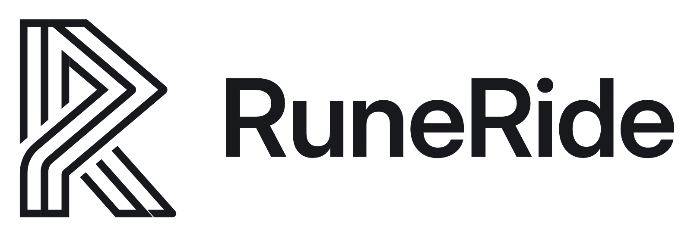

<picture>
  <source media="(prefers-color-scheme: dark)" srcset="./logo-dark-mode.png">
  
</picture>

**Assistant road-trip moto : trajets, ravitaillement au meilleur prix, montage 360°.**
*Motorcycle road-trip assistant: routes, best fuel prices, 360° editing.*

[runeride.fr](https://runeride.fr)

---

## Le projet

RuneRide rassemble ce dont un motard a besoin sur la route : ses trajets sur une carte, la station-service la moins chère sur son chemin, et un atelier pour monter ses balades filmées en 360°.

Les anciens chemins étaient jalonnés de runes pour guider les voyageurs. RuneRide en est la version moderne, sur écran.

## Dépôts

| Dépôt | Rôle |
| :-- | :-- |
| `runeride` | Site vitrine, comptes, trajets GeoRide, ravitaillement (PHP, MariaDB) |
| `runeride-cloud` | Stockage des rushs, montage et export GPU (Rust, AWS) |
| `identity` | Identité visuelle : logo, tokens, polices, lore |

Tous les dépôts sont publics.

## English

RuneRide is a motorcycle road-trip companion: your rides on a map, the cheapest fuel stop along your route, and an editor for your 360° ride footage.

---

Code sous licence [EUPL-1.2](https://eupl.eu/1.2/fr), tout le reste (logos, textes, images) sous [CC BY-SA 4.0](https://creativecommons.org/licenses/by-sa/4.0/deed.fr). Ce projet utilise des outils d'IA (Gemini, Claude) : voir la [notice sur le copyright et l'usage de l'IA](https://github.com/RuneRide/identity/blob/main/NOTICE.md).
